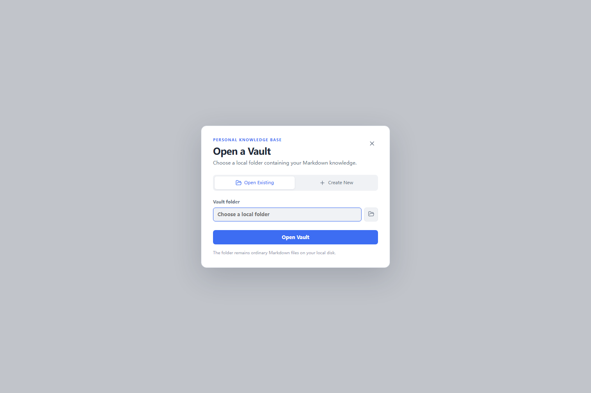
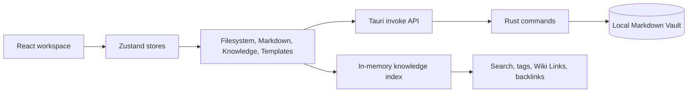

# Personal Knowledge Base

English | [简体中文](./README.zh-CN.md)

> A local-first Tauri desktop workspace for organizing, editing, and connecting portable Markdown notes.

## Overview

Personal Knowledge Base treats a Vault as an ordinary folder on the local disk. Notes remain Markdown files with YAML frontmatter, so the data stays portable and can be opened with other tools. The UI is a three-column workspace: file tree, Markdown editor, and note properties/knowledge links.

**Project status: early MVP / prototype.** The main local Vault workflow is implemented; release hardening, broader automated coverage, and several advanced knowledge features are still planned.

## Implemented features

- Create a new Vault or open an existing local Vault.
- Recursively scan folders and display Markdown notes and assets.
- Read and write Markdown with YAML frontmatter and stable note IDs.
- Edit note content and common properties such as title, category, topic, status, tags, and source.
- Rename and move files or folders, or send them to the Vault trash.
- Search indexed notes by title, path, content, metadata, and tags.
- Extract tags, resolve Wiki Links, report unresolved/ambiguous links, and show backlinks.
- Create notes from blank pages or templates under `90-Templates`.
- Quick capture ideas into `00-Inbox`, browse Inbox notes, and navigate related notes.
- Switch between light, dark, and system themes with keyboard shortcuts for common actions.

## Showcase

The following capture is a real browser preview from `npm run dev`. Native folder selection and filesystem operations require the Tauri desktop shell.



## Architecture



## Tech stack

| Area | Technology |
| --- | --- |
| Desktop shell | Tauri 2 |
| Frontend | React 19, TypeScript, Vite 6 |
| State | Zustand 5 |
| Native layer | Rust 2021 |
| Metadata | YAML frontmatter |
| Testing | Vitest |
| Storage | Local Markdown files; no database |

## Current status and boundaries

**Implemented:** local Vault creation/opening, scanning, Markdown editing, metadata, file actions, search, knowledge links, templates, Inbox, themes, and shortcuts.

**Still planned:** release hardening, broader automated coverage, and additional knowledge features. The browser preview cannot provide Tauri's native folder picker or invoke bridge.

## Getting started

```bash
git clone https://github.com/MountCoder-merry/personal-knowledge-base.git
cd personal-knowledge-base
npm install
npm run dev       # Browser preview
npm run tauri dev # Native desktop workflow
```

Validation commands:

```bash
npm run typecheck
npm run test
npm run build
cargo check --manifest-path src-tauri/Cargo.toml
```

## Project structure

```text
src/app/             # App shell and shortcuts
src/components/      # Workspace, dialogs, editor, sidebar, panels
src/lib/             # Markdown and metadata helpers
src/services/        # Filesystem, knowledge index, templates
src/stores/          # UI and Vault session state
src-tauri/src/       # Tauri commands and native filesystem boundary
docs/                # Architecture, data model, roadmap, and preview capture
```

## License

No license has been declared yet.
